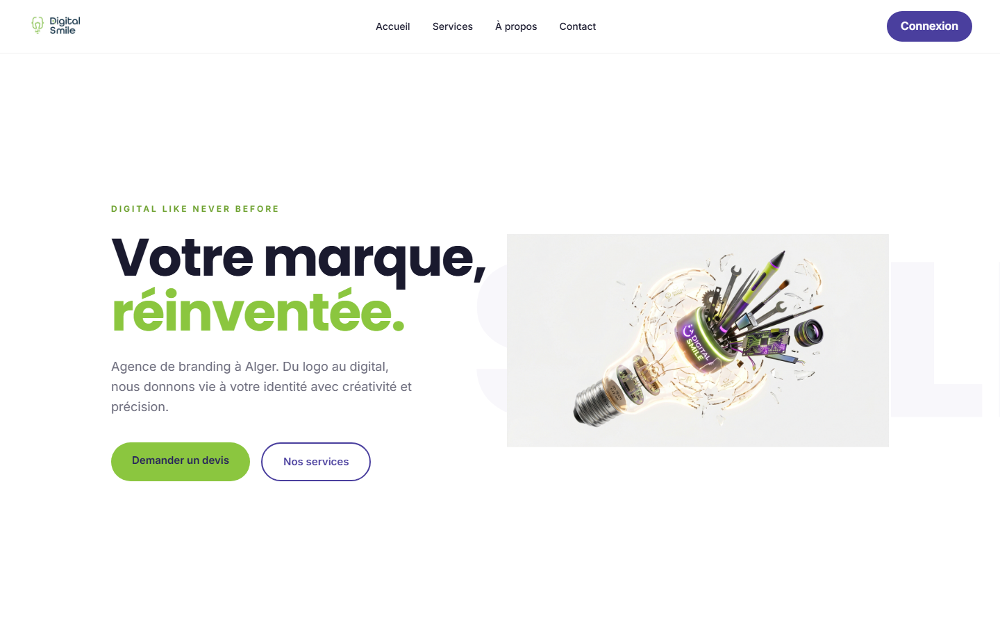
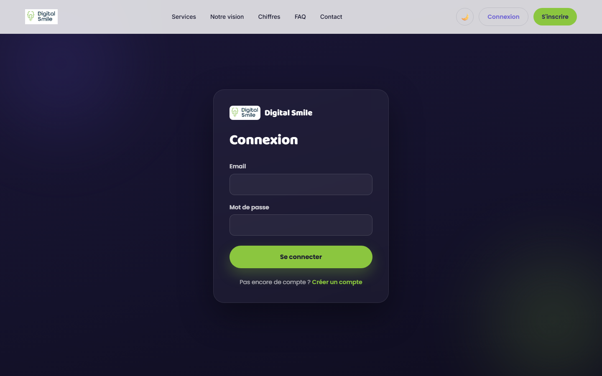

# Digital Smile — Agency Website & Management Platform

A full-stack web platform I built for **Digital Smile**, a branding & creative agency in Algiers.
It combines the agency's public website with a private workspace where **clients order projects, employees deliver them, and admins run the business** — orders, assignments, invoices and notifications in one place.

**Stack:** PHP 8 (no framework, custom MVC) · MySQL · HTML · CSS · JavaScript · Apache



---

## ✨ Features

**Public website**
- Animated homepage: services (branding, print, web, video), portfolio, process, key figures, testimonials, FAQ, contact
- Light / dark theme toggle, interactive gradient hero, responsive on every screen

**Three role-based workspaces**

| Client | Employee | Admin |
|---|---|---|
| Creates project orders (brand, colours, style, deadline, budget) | Sees assigned tasks, updates progress (0–100 %) | Approves / rejects orders and assigns them to the right employee |
| Follows orders and downloads deliverables | Uploads deliverables | Creates employee accounts, manages clients |
| Sees invoices and total billing | Profile with photo and a work library | Dashboard with statistics cards and interactive charts |
| | | Generates invoices (optional 19 % VAT, grouped invoices) with printable PDF |

**For everyone:** in-app notifications · change password · secure login and registration



---

## 🏗️ Architecture

```
public/            ← the only folder exposed to the web (front controller)
  index.php        ← single entry point: config → routes → dispatch
app/
  Core/            ← Router, Database (PDO singleton), base Model, helpers
  Controllers/     ← Auth, Admin, Client, Employee, Notification, Home
  Models/          ← User, Client, Employee, Department, Service, Order, Project, Invoice, Notification
  Middleware/      ← Auth & role guards
  Views/           ← admin/, client/, employee/, auth/, partials/
config/            ← settings kept outside the web root
database/          ← schema (17 tables), migrations, seed data
lang/              ← fr / ar / en
docs/              ← architecture, database, API, deployment, design system, roadmap
```

- **Custom MVC without a framework** — a small router, controllers and models written from scratch to keep the code light and fully understood.
- **17-table relational schema**: users & roles, clients, employees & departments, services, orders, projects, files, invoices & payments, messages, notifications, activity log.

## 🔒 Security

- **PDO prepared statements** everywhere — protection against SQL injection
- **bcrypt password hashing** (`password_hash` / `password_verify`) — no plain-text passwords
- **Role-based access control** with middleware for admin / employee / client routes
- **Config outside the public folder**, **non-executable upload folder**
- **Soft deletes** for traceability

## 🚀 Run it locally

1. Copy the project into your web server folder (e.g. `C:\xampp\htdocs\digital-smile`) and start **Apache + MySQL**.
2. In phpMyAdmin, import `database/schema.sql` (creates the `digital_smile` database).
3. Copy `config/config.local.php.example` to `config/config.local.php` and set your database credentials.
4. Open `http://localhost/digital-smile/public/` — create the first admin with `public/install.php`, using **your own** email and a strong password, then delete the setup scripts.

A detailed step-by-step guide (in French) is in [`docs/INSTALL.fr.md`](docs/INSTALL.fr.md).

## 📚 Documentation

The `docs/` folder contains the project's knowledge base: [architecture](docs/ARCHITECTURE.md), [database](docs/DATABASE.md), [API](docs/API.md), [deployment](docs/DEPLOYMENT.md), [design system](docs/DESIGN_SYSTEM.md), [coding standards](docs/CODING_STANDARDS.md) and [roadmap](docs/ROADMAP.md).

---

**Author:** Hadil Ziane — Software Engineer · [GitHub](https://github.com/Hadil16)

> Contact details, team names and credentials in this public version are placeholders.
